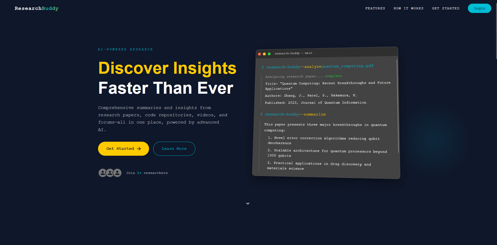
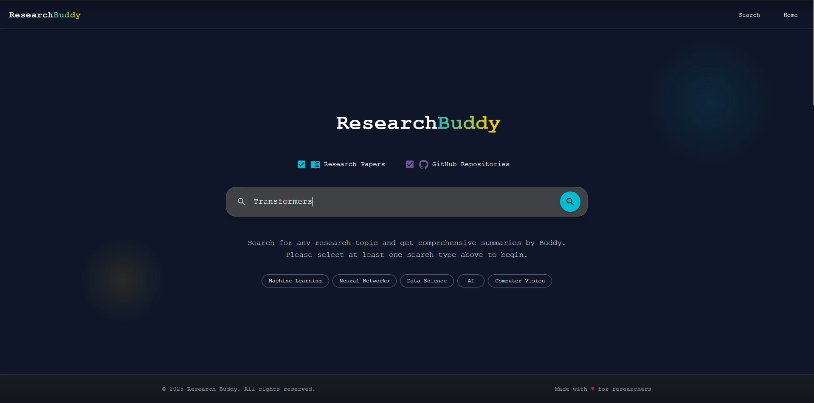
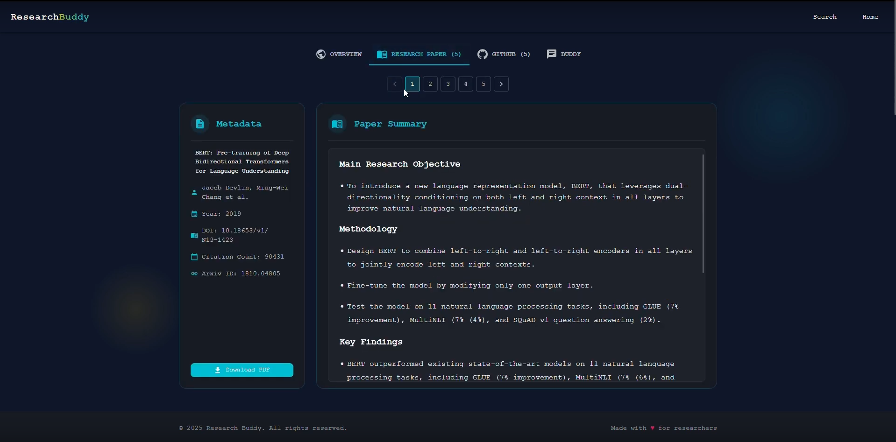
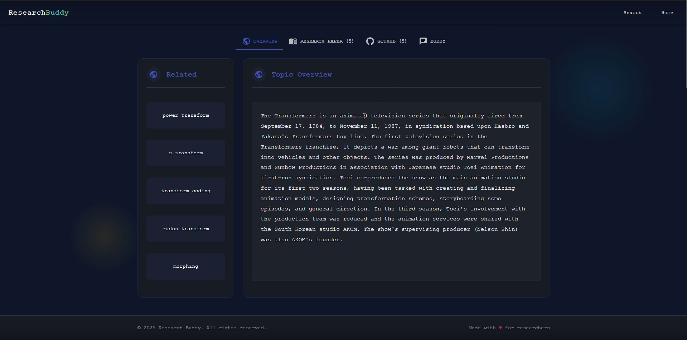
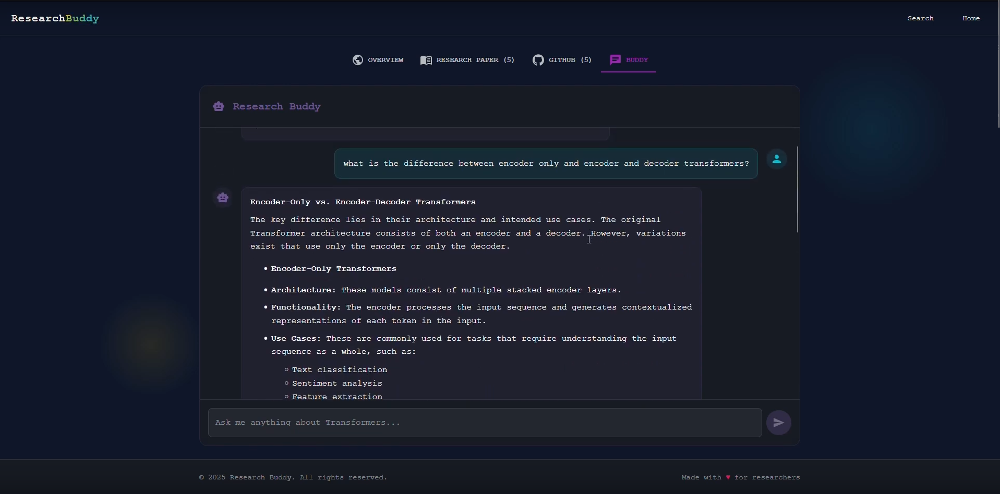
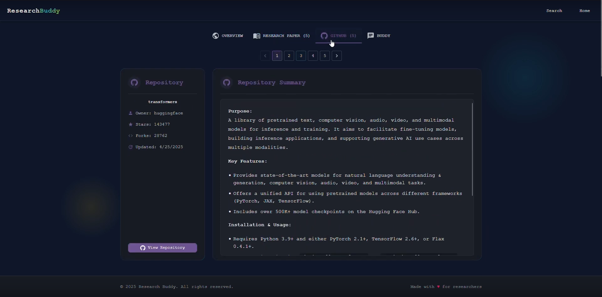

# 📚 ResearchBuddy AI

**ResearchBuddy AI** is a full-stack intelligent assistant that simplifies academic exploration by providing AI-powered summarization, topic understanding, and contextual Q&A. Built for students, researchers, and curious minds looking to make sense of complex technical content without drowning in information overload.

---

## 🚀 Overview

ResearchBuddy supports:
- Summarizing long research papers (up to 16K+ tokens)
- Auto-analyzing GitHub repositories
- Exploring structured Wikipedia topic overviews
- Chatting with a RAG-based assistant trained on 300K+ STEM Q&A pairs (and growing)
- Intelligent search with support for natural language queries

---

## 🧩 Key Features

| Module | Description |
|--------|-------------|
| 📝 **Paper Summarizer** | Fine-tuned LongT5 model provides structured summaries (objective, method, findings, conclusion). |
| 💻 **GitHub Summarizer** | Gemini-powered summaries for `README.md` files and project intros. |
| 🌐 **Wikipedia Explorer** | Retrieves clean intros and related topics via OpenAlex + Wikidata. |
| 🤖 **RAG Chatbot** | Contextual question-answering using 300K+ STEM entries from GitHub, StackExchange, and papers. |
| 💬 **Search + Query Handling** | Query expansion and smart ranking via vector search in Qdrant. |

---

## 🛠️ Tech Stack

| Layer | Tools |
|-------|-------|
| Frontend | React + Material UI (MUI), custom components |
| Backend | Flask API |
| AI Models | `google/long-t5-tglobal-xl` (QLoRA + DeepSpeed Stage 3), `flan-t5-large`  , `mistral 7b` |
| Embeddings | Sentence Transformers |
| Vector DB | Qdrant |
| Deployment | Docker, Docker Compose, GCP L4 VM, Vast.ai RTX 8000 |
| Data APIs | OpenAlex, Gemini, Wikipedia, Semantic Scholar |

---

## 🧪 Training & Evaluation

| Detail | Info |
|--------|------|
| Input Length | 16,384 tokens |
| Training Infra | 2× A100 GPUs using DeepSpeed Stage 3 |
| Dataset | 1000+ ArXiv summaries |
| Evaluation | ROUGE |

---

## 🧠 RAG System Architecture

```
User Query → Embedding → Qdrant Search → Top-k Results → Prompted Context → Final LLM Answer
```

Uses 300K+ Q&A entries and supports expansion to 500K+ entries for improved retrieval accuracy.

---

## 🗂️ Project Structure

```
ResearchBuddy/
├── backend/              # Flask backend with modular folders
│   ├── Chatbot/          # RAG logic & Gemini prompts
│   ├── Github/           # GitHub summarization
│   ├── MongoDB/          # MongoDB connection layer
│   ├── Overview/         # Wikipedia/OpenAlex retriever
│   ├── Qdrant/           # Vector DB setup + upsertion scripts
│   ├── ResearchPaper/    # ArXiv, summarizer, PDF handling
│   ├── Youtube/          # Placeholder YouTube integration
│   └── app.py
├── frontend/             # React + MUI UI
│   └── src/components/   # Buddy, GitHub, Wikipedia, Search, Layout, etc.
├── Phase-1+2+3/          # Notebooks and experiment logs
│   ├── data/             # JSON dataset
│   └── src/              # All training notebooks
├── docker-compose.yml
├── README.md
└── requirements.txt
```

---

## 📸 Screenshots

- HomePage

- Search page

- Summary result cards

- Wikipedia topic page

- RAG chatbot in action

- GitHub repo summarizer



---

## 🐳 Deployment

This project uses Docker for both frontend and backend containers.  
Run locally with:

```bash
docker-compose up --build
```

Make sure `.env` files are set in both `/frontend` and `/backend`.

---

## 🙏 Acknowledgments

- My capstone supervisor and faculty mentors  
- The open-source community and contributors to Qdrant, Hugging Face, and Semantic Scholar

---

## 📬 Contact

**Muhammad Qassim**  
[LinkedIn](https://www.linkedin.com/in/muhammad-qassim/) | [Email](muhammad@qassim.dev)
